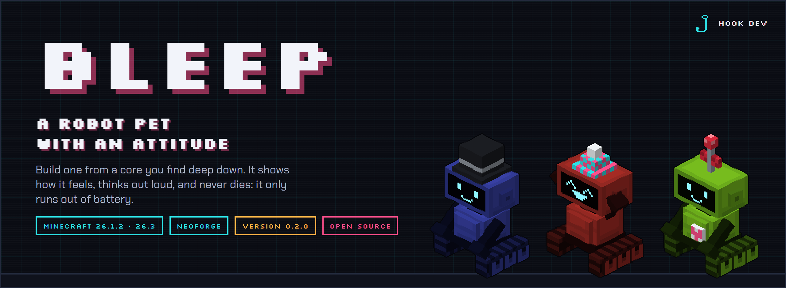
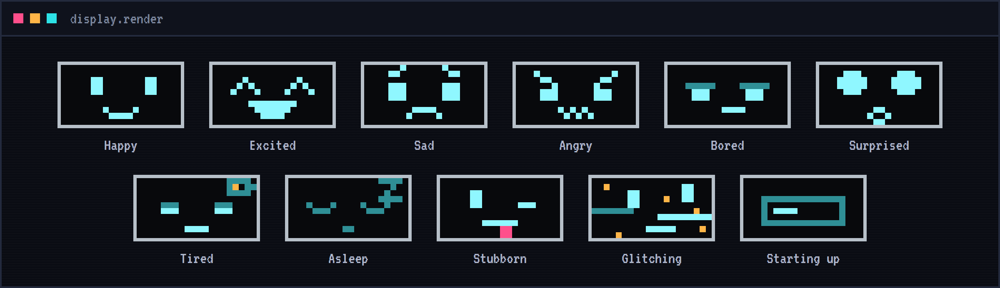
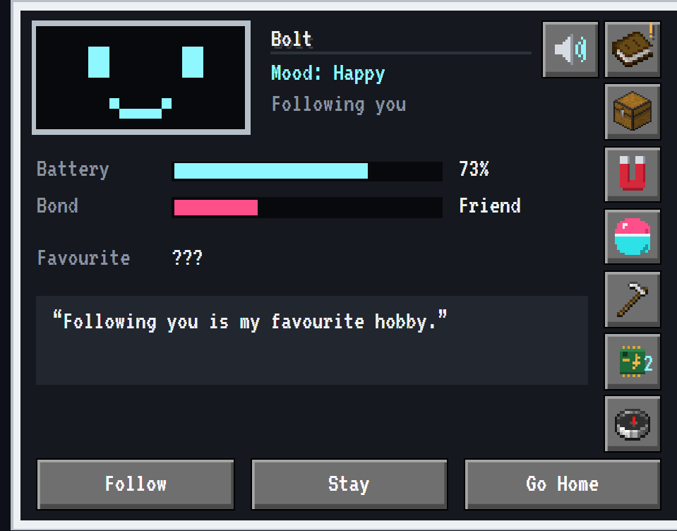
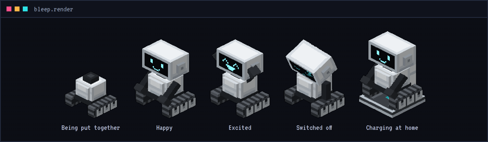
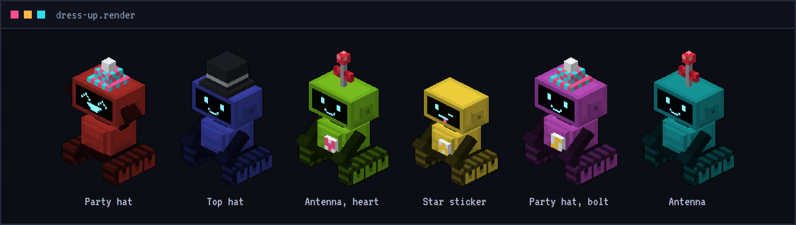
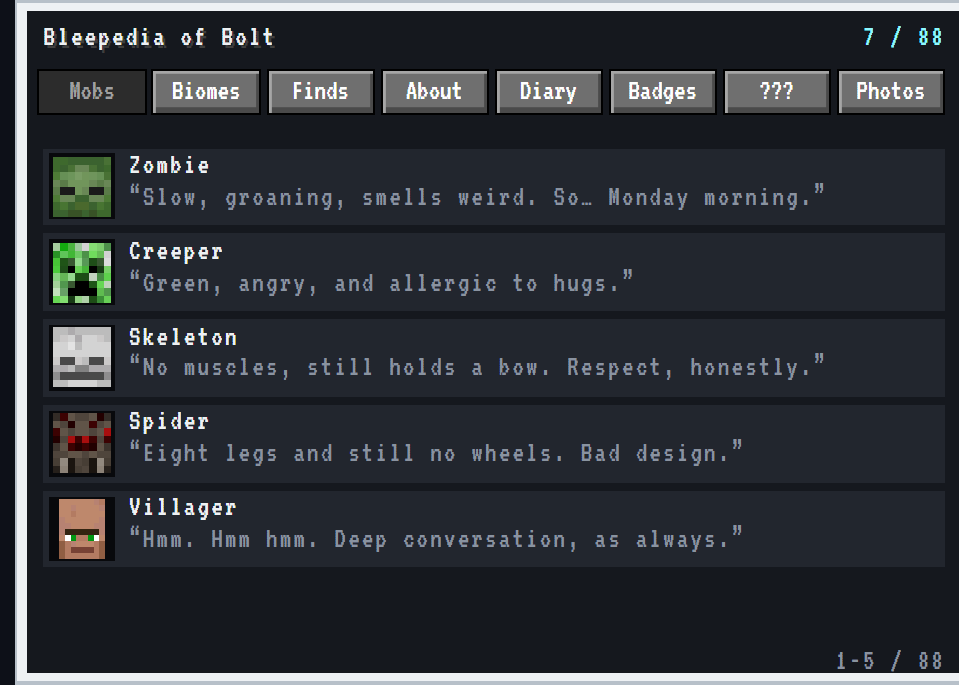
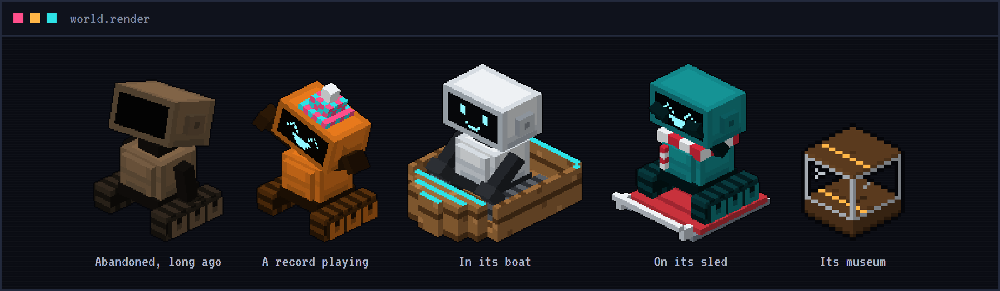
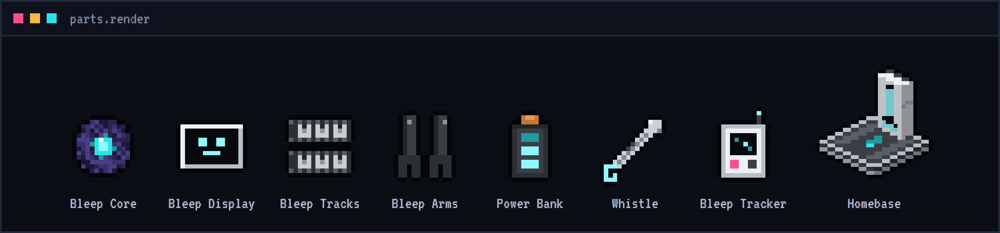

<p align="center">
  
</p>

<p align="center">
  <a href="https://github.com/ParadiseArchive/bleep/actions/workflows/build.yml"></a>
  
  
  
  <a href="LICENSE"></a>
</p>

<p align="center">
  <a href="https://hookdev.io/projects/minecraft-mods/bleep/"><b>Read the docs</b></a> &nbsp;·&nbsp;
  <a href="https://hookdev.io/projects/minecraft-mods/"><b>Devlog</b></a> &nbsp;·&nbsp;
  <a href="https://hookdev.io"><b>hookdev.io</b></a>
</p>

---

Bleep is a Minecraft mod about little robots on tracks with a display for a face. A bleep is not a worker but a pet
with a character: it shows how it feels on its screen, thinks out loud and is a little bit naughty. It never dies: it
only runs out of battery.

**A pet that feels alive.** Look after it and it likes you more: pet it, bring it treats, find out its favourite
thing. A new bleep sometimes dawdles over what you ask; a best friend hardly ever does.

## The heart of it: build your own

A bleep is made of four parts. The most important one is the core: warm, humming, and nobody knows what it is made of.
Find one deep down or in a fallen star, or craft it if you can spare thirteen diamonds (or have eight star shards).

1. Find a **Bleep Core** in the chest of a dungeon or an abandoned mineshaft, or craft one.
2. Craft its **Display**, its **Tracks** and its **Arms** from iron, redstone, black glass and dried kelp.
3. Right-click the ground with the core, the other three in your inventory. Your bleep is put together part by part,
   clunk by clunk, until its screen comes on for the very first time.

From then on it is yours. It follows you, drives circles round you when you hold its favourite item, drives over to
every new kind of mob for a good look, and drives off in a hurry when it sees a llama.

<p align="center">
  
</p>

## Talk to it

Right-click your bleep for its info screen: its face as on its display, its mood and what it is doing, its battery,
your bond, its favourite item (??? until you find out what it is), what it is thinking, and the Follow, Stay (it potters about near the spot) and Go
Home buttons. Sneak-right-click to pet it. It talks back in cute robot chirps, a few for every mood.

<p align="center">
  
</p>

## What is in it

### The bleep
Eleven faces on a display that glows in the dark, arms and a head that move with its mood, and a voice of its own. A
battery instead of health: driving and damage drain it, and an empty bleep switches off with a sleepy face. Charge it on
its homebase, with redstone or a power bank, or let lightning overcharge it. A bond that
grows with care and teaches it new things: a Friend carries a torch that lights the way, a Buddy fights at your side and
brings you what it finds. A favourite item, a dry remark about every mob in the game, naughty tricks when it is bored,
and a fear of llamas nobody can explain.



### Dress it up
Any dye colours its shell. It wears a hat (a party hat, a top hat or an antenna with a bow) and a sticker on its front,
and its display has tricks: its name as a ticker, tic-tac-toe when it is bored, an arrow home.



### The Bleepedia and the world
Every bleep keeps a book: the Bleepedia, behind the book on its info screen. Every mob it met (with its face and its
opinion), every biome it drove through, the special blocks it spotted, its stats and a diary in its own words; a ! on
the book when there is something new. Out in the world it dances when a record plays, sleeps next to your bed, digs up
bits and bobs and adores iron golems. In the water a little boat pops up under it, on snow it rides a sled, and when
it stays somewhere snowy it builds a snowman. It feels rain coming, does impressions of mobs it met, and fills display
cases near its homebase with its favourite things: its own museum. Now and then you find an old, abandoned bleep: a
block of redstone wakes it up.

### Photos
At a nice moment it says Click! and takes a photo of what you see: a sunset with you, a falling star, its best friend,
a new biome. They go in a Photos tab in its Bleepedia, and Print puts one on a map for an item frame.





### Storage and magnet
Every bleep carries a storage as big as a small chest, behind the chest on its info screen. Switch on its magnet and it
pulls in what lies about; now and then it drives over to show you something it found. Put a sword in it and a Buddy
fights with it. Its name is Bleep until you type a new one on its info screen.

### Play and company
Throw a ball and it brings it back. Have more than one bleep and they say hi, chat, play tag, pass the ball, fight
(thunder clouds and all), get jealous and cheer each other up, and become friends, best friends or rivals. A bed, a toy and its name on a sign make its home cosy. It welcomes you home, and every thirty days it has a
birthday (a cake makes its day). Ten bleeps per player.

### Play and work
The ball on its info screen opens Play: hide and seek (it hides, or you do) and tricks, more as the bond grows. The hoe
opens Work while it stays: how far it goes from its spot, and its jobs: farmer, guard at night, tidy up into a chest,
fisher, smelter and gardener.

### Chips and letters
Three upgrade chips: speed, shield and a bigger battery. The chip on its info screen shows which are in, and takes one
out again. And a bleep that likes you writes you a
letter now and then, from its diary, and brings it over.

### From the stars
Where do bleeps come from? On a clear night, very rarely, a star falls: a crater of glowing starstone, a fallen star
in the middle, sometimes with a core inside. Bleeps look up at night, sing together at full moon, and fill a page of
their Bleepedia with signs nobody can read. Hints, never an answer.

### It looks after you
When you die, it gathers up your things where you fell and gives them back when you return. Low on health or food, it
brings you something to eat from its storage, and it warns you when a creeper is about to go off behind you.

### Hobbies and badges
What a bleep does most in its free time becomes its hobby (stargazing, digging, collecting, dancing, chatting or
playing), and then it does it even more. Its Bleepedia has a Badges tab: twenty milestones to reach. And it reacts to
what you do with a little picture on its screen: a heart when you eat, sweat when you fall, sparkles when you level up.

### Adventures
Underground it warns you for lava and deep drops, and with a pickaxe in your hand it beeps warmer near ore. It rides
a minecart behind yours like a train. Give it emeralds and it goes shopping at the nearest villager.

### Treasure hunt
It buries something and its screen tells you warmer or colder while you dig. Or you hide something, and it sniffs
about until it finds it.

### Dreams
At night on its homebase it dreams, and its screen shows bits of its day: a mob, a little scene, a falling star.
Very rarely, something strange.

### Show the way
Lost? The compass on its info screen: it drives ahead to its homebase (or your bed), leaving a glowing trail.

### Cool clothes
Sunglasses over its screen, a leather jacket, a cape that swings out as it drives, a bow tie, a scarf and a crown:
one thing in each place, on top of its hat and sticker.

### Herder and lumberjack
Two more jobs while it stays: it shears sheep and feeds animals so they have young, and it fells real trees and
plants a sapling where they stood.

### Questions
Now and then it asks you something, yes or no. It remembers, and brings it up again later.

### Parts and home
The core and the three parts a bleep is built from, a power bank, a whistle that calls your bleeps, a Bleep Tracker that
shows where they all are, and the homebase: a charging pad it goes home to when it runs empty, and that Go Home sends
it to. A homebase charges from a battery of its own: fill it with redstone, a block of redstone or FE from cables.
Hoppers and pipes reach the storage of the bleep parked on it.



## Get it

**0.2.0** is out: download it from the [GitHub releases](https://github.com/ParadiseArchive/bleep/releases)
(CurseForge is on its way). What is new is in
[the changelog](release/changelog/0.2.0.md).

- Minecraft 26.3 or 26.1.2 (the version of All the Mods 11) with NeoForge, Java 25: pick the file for your Minecraft version
- In-game help: tooltips on every part, and in JEI every recipe and where the core is found
- Works with Jade (battery, mood and bond when you look at a bleep) and JEI
- Thirteen advancements, and a config for pack makers (bleeps per player, battery drain, homebase power, falling stars and more)
- Stand-alone: no other mod needed

The full documentation, with every face, part, recipe and the info screen, is on
**[hookdev.io](https://hookdev.io/projects/minecraft-mods/bleep/)**.

## Building

```
./gradlew build               # jar for Minecraft 26.3 in build/libs
./gradlew build -Pmc=26.1     # jar for Minecraft 26.1.2 in build-26.1/libs
./gradlew runClient           # start a development client
./gradlew runGameTestServer   # run the automated in-game tests
```

Every push is built and tested by GitHub Actions. The pictures in this README come from `tools/readme-art.mjs`.

## License

Copyright (c) 2026 Hook Development. Bleep is free software under the GNU General Public License v3.0 only, see
[LICENSE](LICENSE): you may use, change and share it, as long as what you share is under the same license, with its
source. Modpacks are welcome. The ideas, the character and the gameplay are Hook Development's; the code and the
textures are written with Claude, an AI assistant.
Minecraft names used in code come from Mojang's official mappings, see https://github.com/NeoForged/NeoForm/blob/main/Mojang.md.

<sub>NOT AN OFFICIAL MINECRAFT PRODUCT. NOT APPROVED BY OR ASSOCIATED WITH MOJANG OR MICROSOFT.</sub>

<p align="center"><a href="https://hookdev.io"><sub>made by Hook Development</sub></a></p>
