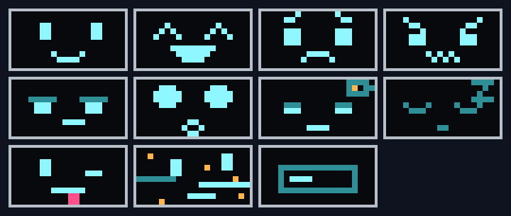

# Bleep


Little robots on tracks with a display for a face. A bleep is a pet with a character: it shows how it feels, thinks out loud and is a bit naughty. It never dies, it only runs out of battery. A Minecraft mod for NeoForge, on Minecraft 26.3 and 26.1.2, by Hook Development.

- **Build your own** from four parts found around the world: the core in the Trial Chambers, the display in an Ancient City, the tracks at a village smith, the arms in a bastion.
- **Eleven faces** on a glowing display, and a blip for every mood.
- **A battery and a homebase** to charge at.
- **A bond you build**, a favourite item, a dry remark about every mob, and a fear of llamas.
- **Jade and JEI** support when you have them.



Docs: https://hookdev.io/projects/minecraft-mods/bleep/

## Building

```
./gradlew build                 # Minecraft 26.3: build/libs/bleep-<version>+mc26.3.jar
./gradlew build -Pmc=26.1       # Minecraft 26.1.2: build-26.1/libs/bleep-<version>+mc26.1.2.jar
./gradlew runGameTestServer     # the game tests (add -Pmc=26.1 for 26.1.2)
node tools/gen-assets.mjs       # textures, models, language file
```

Made with AI: the ideas, the character and the gameplay are Hook Development's; the code and the textures are written with Claude, an AI assistant.

MIT licence.
