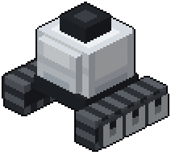
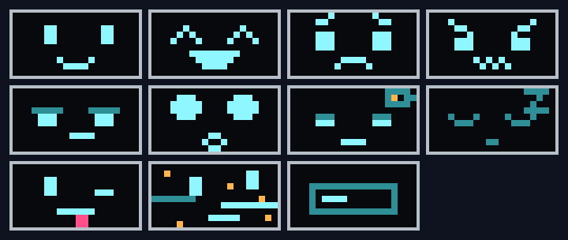
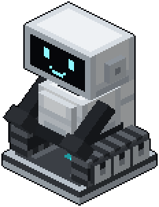

# Bleep

**Little robots on tracks with a display for a face.**

A bleep is not a worker but a pet with a character. It shows how it feels on its screen, thinks out loud and is a little bit naughty. It never dies: it only runs out of battery.

## Build your own

A bleep is made of four parts, spread over the whole world:

- **Bleep Core:** the heart, made of bedrock. In an ominous vault of the Trial Chambers.
- **Bleep Display:** its face. In the chests of an Ancient City.
- **Bleep Tracks:** what it drives on. At a village weaponsmith or toolsmith.
- **Bleep Arms:** big enough to hold things. In the chests of a bastion.

Use the core on the ground with the other three in your inventory, and your bleep is put together there, part by part, until its screen comes on for the very first time.

## How it feels

Its display glows in the dark and shows eleven faces: happy, excited, sad, angry, bored, surprised, tired, asleep, stubborn, glitching, and the start-up screen. It blinks now and then, its arms and head move with its mood, and it talks in little blips, a sound for every mood.

## A battery and a home

- **A battery instead of health.** Driving and damage drain it. Below 20 % it looks tired and drives slower; at 0 % it switches off with a sleepy face.
- **A homebase.** Craft a charging pad and place it near your bleep: it moves in. An empty bleep goes home to charge, and the Go Home button sends it there.

## A bond you build

Right-click your bleep for its info screen: its mood, what it is doing and thinking, its battery, your bond and its favourite item, with Follow, Stay and Go Home. Sneak-right-click to pet it.

- **The better you look after it, the more it likes you.** Petting, treats, its favourite item and days together raise the bond; hitting it, leaving it alone or breaking its home lower it.
- **It does not always listen.** A new bleep sometimes dawdles: a stubborn face, a turn on the spot, and then it does it anyway. A best friend hardly ever does.
- **Its favourite thing.** Every bleep is crazy about one item, and drops hints about it in its thoughts. Hold it and it drives circles round you; if it finds one lying about, it gets so excited it glitches.
- **A remark for every mob.** The first time it sees a kind of mob, it drives over for a good look and thinks something dry about it.
- **Afraid of llamas.** Nobody knows why.

## Works with

- **Jade:** battery, mood and bond when you look at a bleep, and who lives in a homebase.
- **JEI:** the homebase recipe, and where every part is found.

Bleep is a stand-alone mod for NeoForge, on Minecraft 26.3 and 26.1.2. Full docs: https://hookdev.io/projects/minecraft-mods/bleep/

## About

Bleep is designed by Hook Development: the ideas, the character and the gameplay. The code and the textures are written with Claude, an AI assistant. Open source under the MIT license: https://github.com/ParadiseArchive/bleep
